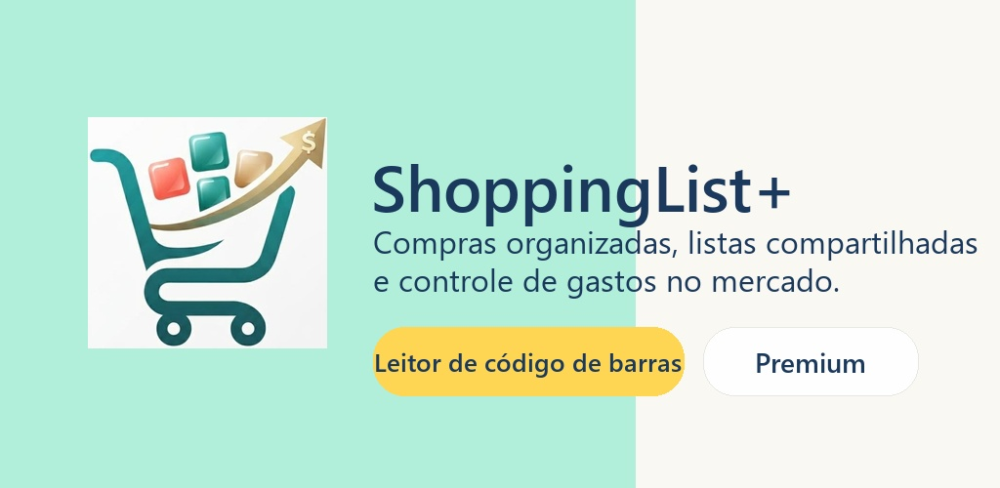
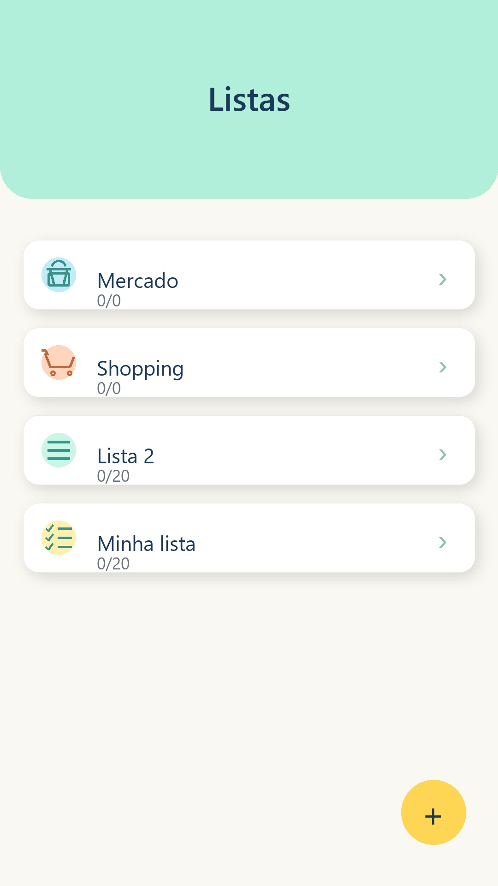
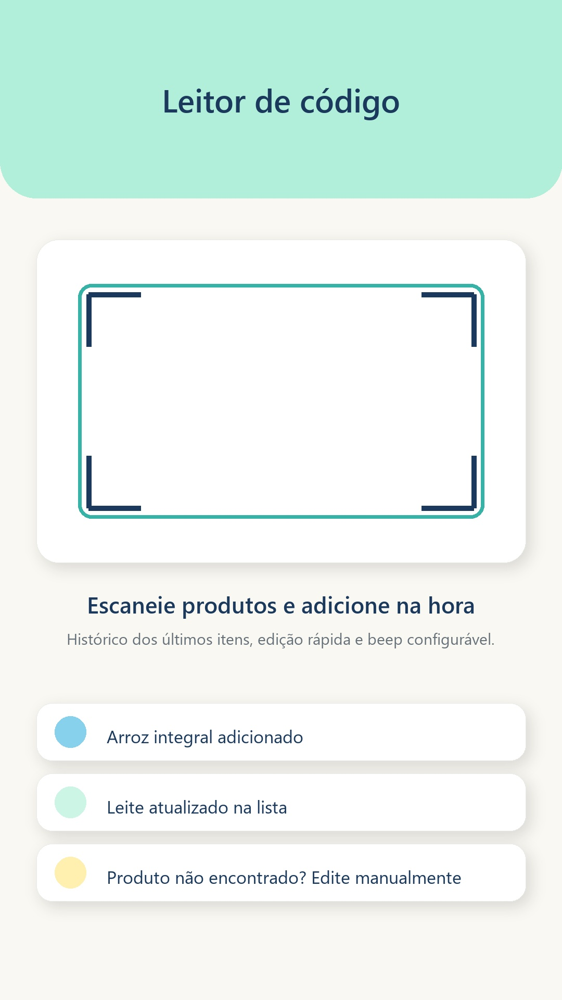

# ShoppingList+

### Suas compras organizadas. Seus gastos sob controle.

**[Baixar na Google Play](https://play.google.com/store/apps/details?id=com.violettechgroup.shoppinglistmais)**

ShoppingList+ é um aplicativo Android para organizar compras, listas, preços e despesas em um só lugar.

## Do planejamento ao carrinho

Crie listas para diferentes ocasiões, adicione produtos e acompanhe os valores para comprar com mais organização.

## Recursos

- listas de compras;
- busca, histórico e arquivamento;
- leitura de códigos de barras;
- comparação de preços e rota econômica;
- compartilhamento de listas;
- controle de despesas e relatórios;
- recursos Premium e sincronização online.

Alguns recursos dependem de conexão, conta ou assinatura Premium.

## Conheça o visual

Materiais promocionais do projeto, mostrando a organização de listas e o leitor de códigos de barras. A aparência pode variar conforme a versão instalada.

  
  &nbsp;&nbsp;
  

## Tecnologia

Aplicativo Android nativo desenvolvido em Kotlin, com Gradle, Room e Retrofit/Gson.

Desenvolvido pela **[VioletTech Group](https://github.com/violettechgroup)**.

## Código-fonte

O código-fonte completo é mantido em um repositório privado. Este repositório público contém apenas a apresentação do projeto.

## Aplicativo

**[Instale o ShoppingList+ na Google Play](https://play.google.com/store/apps/details?id=com.violettechgroup.shoppinglistmais)**

Este repositório não concede licença de uso ou redistribuição do código, do aplicativo, da marca ou dos materiais apresentados.
